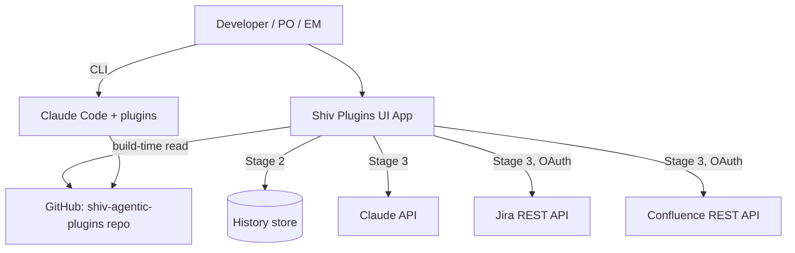
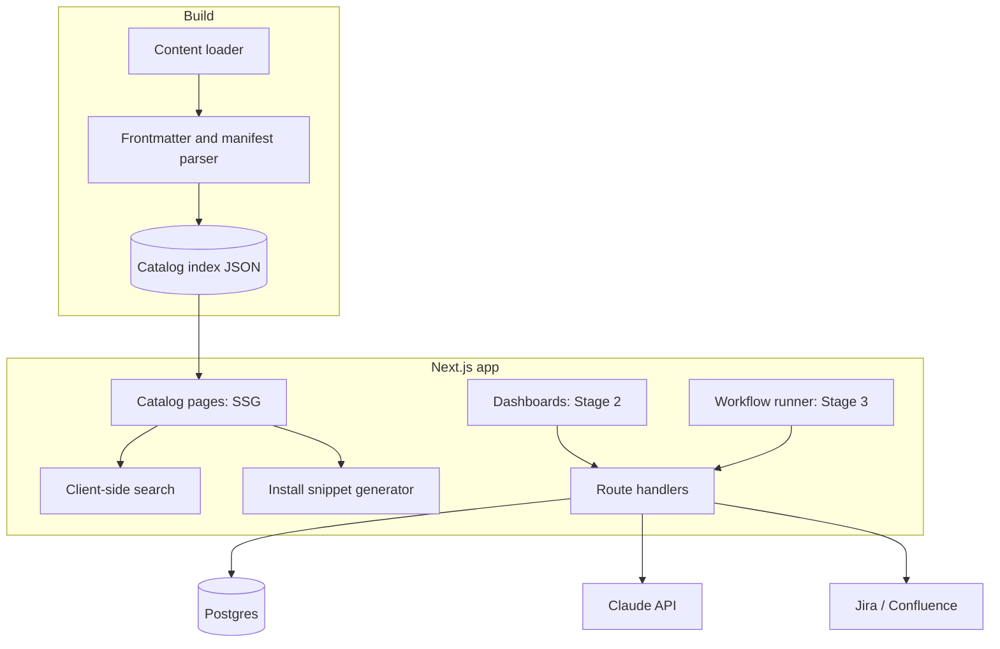

# Technical Architecture - Shiv Plugins UI App

> **Status**: DRAFT | **Last Updated**: 2026-10-05 | **Author**: Shivendra Hada

## Status

Draft. Generated with `--dry-run`: local only, not published to Confluence, no Jira context. Source of requirements is [APP_CAPABILITIES.md](../../../APP_CAPABILITIES.md). Clarification answers were accepted as defaults (see Assumptions).

## Context & Background

This repository is a Claude Code plugin marketplace (`shiv-agentic-plugins`). It ships five plugins (`shiv-agile`, `shiv-design-docs`, `shiv-dev`, `shiv-speckit`, `shiv-tools`) made of markdown commands, skills, and agents, installed via `install-shiv-plugins.sh` and registered in `.claude-plugin/marketplace.json`.

Today, discovery and use are CLI-only. Anyone who does not already know which commands exist has to read the repo or the README. Product owners and engineering managers, who benefit most from the agile and design-doc flows, rarely work in a terminal.

A UI app would improve discoverability first, then surface quality data (INVEST scores, story KPIs, design-doc sync status), and optionally run selected workflows for non-CLI users.

**Guiding principle:** the app never owns plugin logic. `plugins/` and `marketplace.json` remain the single source of truth; the app reads them.

### Assumptions

1. The app is a Next.js application deployed on Vercel. Plugin markdown and `marketplace.json` are read from GitHub at build time.
2. First release is Stage 1 only: a static catalog with search. Stages 2 and 3 are designed at a high level.
3. Primary users are developers. POs and EMs are the Stage 3 audience.
4. Jira and Confluence integration (Stage 3) uses their REST APIs with per-user OAuth. No site-specific identifiers are hardcoded.
5. Any write to Jira, Confluence, or GitHub is previewed and needs explicit user approval.
6. Score and KPI history (Stage 2) is stored in a managed Postgres or Vercel Marketplace storage.

## Scope

### In Scope

- **Stage 1 (detailed):** plugin catalog, command/skill/agent listing, search, install snippets, manifest validation view.
- **Stage 2 (high level):** read-only dashboards for INVEST trends, story quality KPIs, and design-doc sync status.
- **Stage 3 (high level):** workflow runner for `create-story`, `story-invest-score`, then other commands.

### Out of Scope

- Replacing or duplicating the CLI plugins.
- A plugin marketplace for third-party plugins.
- In-browser editing of plugin markdown (listed in capabilities as Stage 3 future work, not designed here).
- Multi-tenant SaaS billing and organization management.

## Architecture Overview

### System Context Diagram



### Component Diagram



| Component | Stage | Responsibility |
|---|---|---|
| Content loader | 1 | Fetch `marketplace.json` and `plugins/**` from GitHub at build time |
| Parser | 1 | Extract plugin metadata, command/skill/agent frontmatter, argument hints |
| Catalog pages | 1 | Statically generated pages per plugin and per command |
| Search | 1 | Client-side index (no backend) over names, descriptions, argument hints |
| Install snippet generator | 1 | Build copy-paste install commands from manifest data |
| Manifest validator | 1 | Flag missing frontmatter, unregistered plugins, version mismatches |
| Dashboard service | 2 | Aggregate stored scores and sync status for charts |
| Workflow runner | 3 | Load a command's markdown as prompt, call Claude, preview, then write on approval |

## Design Decisions

### Decision 1: Read plugins at build time, never copy them

- **Context:** The CLI and the app must not drift.
- **Options:** (a) copy prompts into the app; (b) read from the repo at build time; (c) read at request time.
- **Decision:** (b). A rebuild is triggered on push to `main` (webhook). Output is static, fast, and always matches the repo.
- **Consequence:** Content updates take one build cycle. Acceptable for a catalog.

### Decision 2: Next.js on Vercel

- **Context:** Needs static generation now and server routes later (Stage 2 and 3).
- **Decision:** Next.js App Router. SSG for catalog, route handlers for later stages.
- **Alternatives rejected:** a pure static site generator (no path to Stage 3), a separate SPA plus backend (more moving parts).

### Decision 3: Stage the rollout

- **Decision:** Ship Stage 1 alone. Build Stage 2 and 3 only on demand from non-CLI users.
- **Rationale:** Stage 1 carries almost no auth, secrets, or runtime risk and delivers the discoverability win.

### Decision 4: Drafts and approval for every external write

- **Decision:** The runner produces a draft and a preview. Jira, Confluence, and GitHub writes happen only after explicit approval, matching the existing TDD and Terraform flows.

### Decision 5: Client-side search

- **Decision:** Ship a prebuilt JSON index and search in the browser. The catalog is small (tens of commands), so no search service is needed.

## Data Model

**Stage 1 (build-time, no database).** Catalog index generated from the repo:

```typescript
interface CatalogIndex {
  generatedAt: string;
  commitSha: string;
  plugins: Plugin[];
}

interface Plugin {
  name: string;          // e.g. "shiv-agile"
  version: string;
  description: string;
  category: string;
  commands: Command[];
  skills: Skill[];
  agents: Agent[];
}

interface Command {
  name: string;          // e.g. "create-epic"
  description: string;
  argumentHint?: string;
  sourcePath: string;
}
```

`Skill` and `Agent` carry `name`, `description`, `sourcePath`, and `tools` (agents only).

**Stage 2 (history store).** Tables, indicative:

| Table | Key columns |
|---|---|
| `story_scores` | `story_key`, `team`, `sprint`, `invest_scores` (json), `total`, `scored_at` |
| `epic_scores` | `epic_key`, `smart_scores` (json), `total`, `scored_at` |
| `doc_sync_status` | `doc_path`, `confluence_page_id`, `last_synced_at`, `state` |

Where these rows come from (CLI export, runner results, or Jira polling) is an open question.

## API Contracts

**Stage 1:** none. Pages are static.

**Stage 2 and 3 (indicative route handlers):**

| Route | Method | Purpose | Stage |
|---|---|---|---|
| `/api/scores` | GET | Score history, filterable by team and sprint | 2 |
| `/api/kpis` | GET | Aggregated story quality KPIs | 2 |
| `/api/docs/status` | GET | Design doc sync status | 2 |
| `/api/runs` | POST | Start a workflow run, returns draft and preview | 3 |
| `/api/runs/{id}/approve` | POST | Approve and perform external writes | 3 |
| `/api/auth/atlassian/*` | GET | OAuth flow for Jira and Confluence | 3 |

Exact schemas are defined in a follow-up `api-design` document before Stage 2.

## Security Considerations

- **Stage 1:** public static content from a repo. If the repo is private, the build uses a read-only GitHub token held only as a build environment variable, never exposed to the client.
- **Secrets:** Claude API key and OAuth client secrets are server-side environment variables only.
- **Auth (Stage 3):** per-user Atlassian OAuth 3LO. Tokens are stored encrypted and scoped to the minimum required. No shared service account for writes, so audit trails show the real user.
- **Multi-tenancy:** no hardcoded `cloudId`, space key, or project key. Resolved from the signed-in user's account, as the plugins already do.
- **Prompt injection:** Jira and Confluence content is untrusted input to the runner. It is passed as data, never as instructions, and the approval step is the control for any write.
- **Audit log:** every external write records who, what, target, and timestamp.

## Performance Considerations

- **Stage 1:** fully static, served from the CDN. Target Lighthouse performance 95 or higher. Search index under roughly 200 KB.
- **Stage 2:** dashboard queries read pre-aggregated data. Page loads should stay under 2 seconds.
- **Stage 3:** Claude calls are slow, so runs are streamed or run asynchronously with status polling. Keep per-run timeouts and cost caps.

## Deployment Strategy

- **Hosting:** Vercel. Preview deployments per PR, production from `main`.
- **Build trigger:** GitHub push webhook on `main` rebuilds the catalog.
- **Config:** environment variables for GitHub token (if private), later the Claude API key, OAuth credentials, and database URL.
- **Rollout:** Stage 1 first. Stage 2 and 3 are separate releases behind feature flags.
- **Rollback:** Vercel instant rollback. Stage 1 has no state to migrate.

## Risks & Mitigations

| Risk | Impact | Mitigation |
|---|---|---|
| App drifts from plugin content | Stale or wrong docs | Build-time read only, rebuild on every push to `main` |
| Plugin frontmatter is inconsistent | Parser gaps, broken catalog | Manifest validator reports problems at build time and fails CI on errors |
| Little non-CLI demand | Stage 2 and 3 wasted | Ship Stage 1 first, gate later stages on real requests |
| Stage 3 writes bad data to Jira | Data quality, trust loss | Draft, preview, explicit approval, and an audit log |
| Atlassian OAuth and token handling | Security exposure | Minimum scopes, encrypted storage, no hardcoded tenants |
| Claude API cost growth | Budget overrun | Per-user and per-run caps, usage logging |
| Two execution paths (CLI and app) diverge in behavior | Inconsistent results | Runner loads the same markdown prompts as the CLI |

## Open Questions

1. Is the source repo public or private? This affects build-time access and whether the catalog can be public.
2. Who owns hosting, and does the app live under a company Vercel team?
3. Where does Stage 2 data come from: CLI result exports, runner results, or Jira polling?
4. Do POs and EMs actually want a workflow runner, or is the catalog enough?
5. Which workflows should the runner support first, beyond `create-story` and `story-invest-score`?
6. Should the app require sign-in at all in Stage 1?
